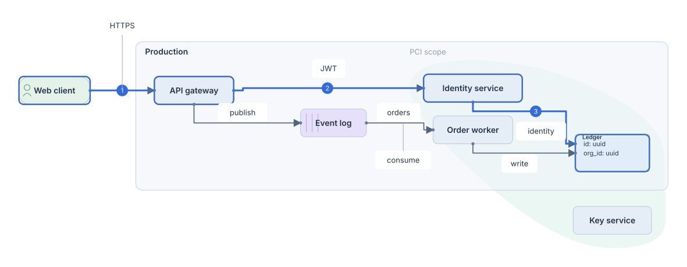

# Smarter Diagrams

A Rust library for diagrams authored in text, with a lossless Rowan syntax tree, source-preserving canvas edits, deterministic orthogonal layout, and native/Wasm integrations.

[Documentation](https://robot-head.github.io/smarter-diagrams/) · [Live playground](https://robot-head.github.io/smarter-diagrams/playground.html) · [Rust API](https://robot-head.github.io/smarter-diagrams/api/smarter_diagrams/index.html)

```text
client -> gateway: HTTPS
gateway -> auth: JWT
auth -> postgres: SQL
```



## Use the library

The source is available on GitHub; this version is not published to crates.io.

```toml
[dependencies]
smarter-diagrams = { git = "https://github.com/robot-head/smarter-diagrams", branch = "main" }
```

```rust
let diagram = smarter_diagrams::compile("client -> gateway: HTTPS\n")?;
std::fs::write("diagram.svg", diagram.to_svg())?;
```

For incremental work, keep a `Document` or pass a prior `Layout` to `compile_with`. Document edits are version checked, compiled atomically, and recorded as one undo step. Failed edits leave the current snapshot unchanged.

```rust
use smarter_diagrams::{Document, edit::{DiagramEditOp, PinExpr, Placement}};

let mut doc = Document::new("client\ngateway\n")?;
doc.edit(doc.revision(), &[
    DiagramEditOp::PinNode {
        node: "gateway".into(),
        pin: PinExpr::AbsoluteGrid { x: 16, y: 0 },
        size_lock: None,
    }
], Placement::Auto)?;
assert!(doc.source().contains("@pin(grid: 16, 0)"));
assert!(doc.undo());
```

## Progressive notation

Ports support free attachment, fixed sides, clockwise order, proportional offsets, and named grid slots. A grid unit is 16 px; pins locate node **centroids**.

```text
prod: Production {
  gateway.E -> broker.W@0.25: publish
  worker.S(order: 1) -> postgres#id: write
  postgres: Ledger [shape: sql_table] {
    port id: uuid [side: W, pos: 1]
  }
}
kms: Key service
zone pci "PCI scope" around [prod.postgres, kms] {
  padding: 1.5g
  tint: oklch(0.72 0.14 35 / 0.12)
}
@layout {
  kms @pin(grid: 32, 8)
}
```

Containers own their children. Zones, alignments, distributions and flows reference entities without reparenting them. Qualified IDs and lexical scope resolve references. Named grid slots must be declared; a side-qualified named port such as `broker.E#orders` is inferred. Edge chains and `->`, `<->`, `--`, `==>` are supported.

`view name { include gateway -> auth -> * }` projects a canonical model. `@layout(name)` selects an alternate layout through `LayoutOptions::variant`. See [the complete example](examples/architecture.diagram) and [architecture notes](docs/architecture.md).

## CLI and editors

```sh
cargo install --path . --features export
smarter-diagrams examples/architecture.diagram -o architecture.svg
smarter-diagrams examples/architecture.diagram --format png -o architecture.png
smarter-diagrams examples/architecture.diagram --format pdf -o architecture.pdf
smarter-diagrams examples/architecture.diagram --view request_only --format check
smarter-diagrams mcp
```

Input defaults to stdin. Formats are `svg`, `json`, `check`, `lint`, and, with the optional `export` feature, `png` and `pdf`. `edit --operations JSON` accepts the typed edit algebra and emits the resulting source. The MCP stdio server exposes open, render, revision-checked edit and lint tools with explicit JSON schemas.

The [VS Code adapter](extensions/vscode) provides a live visual preview, diagnostics and atomic structured edits. Configure `smarterDiagrams.binary` after installing the CLI. The [Neovim adapter](extensions/neovim) opens a loopback browser preview and refreshes it as the buffer changes:

```lua
vim.opt.runtimepath:append('/path/to/smarter-diagrams/extensions/neovim')
require('smarter_diagrams').setup({ binary = 'smarter-diagrams' })
-- :DiagramPreview
```

Neovim 0.11+ and Node are required for that preview transport.

## Wasm and executable extensions

```sh
rustup target add wasm32-unknown-unknown
cargo install wasm-bindgen-cli --version 0.2.130 --locked
scripts/build-wasm.sh core
scripts/build-wasm.sh runtime
python3 -m http.server 8765 --bind 127.0.0.1
# Open http://127.0.0.1:8765/web/
```

The core bundle provides rendering, layout JSON, typed edits, document snapshots, undo/redo, canvas gestures and causal focus. The runtime bundle is loaded separately for queue simulation, bounded verification, strata and Spatial Git. The browser examples include a 60 Hz simulation worker, load control, connector cuts, a WebGPU stratum renderer with flat SVG typography, and a branch morph viewer.

Rust modules expose:

| Module | Capability |
| --- | --- |
| `syntax`, `model` | Lossless CST, typed views, scoped relational IR and source origins |
| `edit`, `document` | Atomic patches, semantic gestures, revisions and undo/redo |
| `topology`, `solver`, `routing`, `labels` | Bounded cyclic search, VPSC, orthogonal routes, labels and autodiff polish |
| `views` | Canonical projections, intersecting lenses, fisheye compaction, C1 zoom and attention cones |
| `simulation` | Fluid queues, bounded capacity, workers, delayed retries and edge cuts |
| `drift` | OTLP parent/child edges, code bindings, phantom hydration, promotion and CI boundary checks |
| `formal` | Finite-state SAT checking through horizon 12 and counterexample frames |
| `spatial` | Independent strata and stable branch union/morph layouts |
| `lint`, `mcp` | Heuristic findings, a caller-supplied visual critic and MCP tools |

Optional features are `export`, `code-bindings` (Tree-sitter Rust symbols), `verification` (continuous document checking), `wasm`, and `wasm-runtime`. External telemetry and VLM transport are supplied by the embedding application; the library itself makes no network calls.

## Validation and limits

```sh
cargo fmt --check
cargo clippy --locked --all-features --all-targets -- -D warnings
cargo test --locked --all-features
cargo bench --bench pipeline
npm ci
node scripts/browser-test.cjs
node scripts/browser-benchmark.cjs
node scripts/measure-wasm.cjs
```

[Performance measurements](docs/performance.md) distinguish cold layout from incremental queries. Search and polish have explicit budgets; a bounded search retains a feasible incumbent. Geometrically inconsistent pins/size locks produce diagnostics. Intermediate Spatial Git animation frames interpolate geometry; canonical compiled layouts receive hard geometry validation.

The implementation uses its own bounded macro-placement search, active-set/dual projection, forward autodiff and query memoization. It does not depend on domus, ELK, Rose or Salsa. [RFC-001](docs/requirements/RFC-001.txt) is the supplied architectural blueprint; [the issue map](docs/github-plan.json) records implementation and validation evidence.
